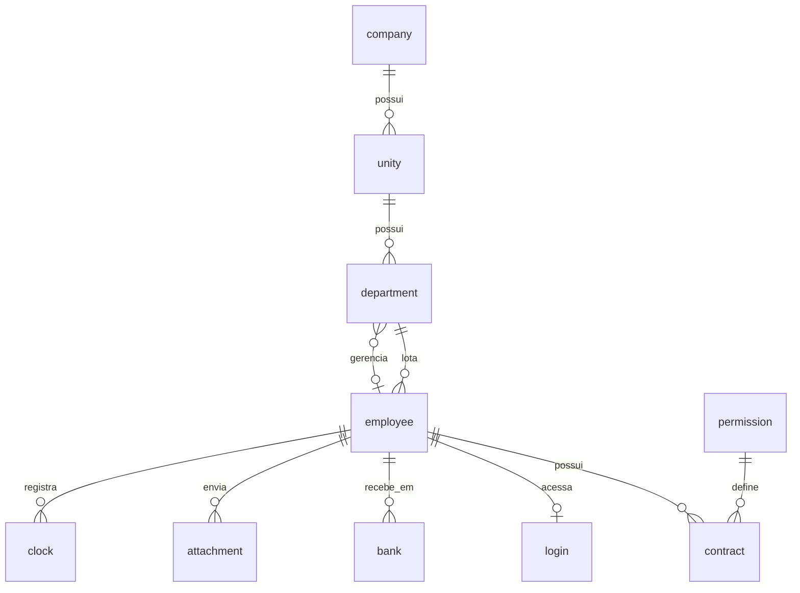

# CHRONIX: Sistema de Gestão de RH e Controle de Ponto

Banco de dados relacional para gestão de funcionários, contratos, documentos, controle de ponto e acessos ao sistema, simulando uma organização com várias empresas, unidades e departamentos.

## 📖 Sobre o projeto

A **Chronix** é uma empresa fictícia de tecnologia para gestão de recursos humanos, com foco no controle da jornada de trabalho. O sistema substitui o controle manual e pouco confiável de ponto, reduzindo retrabalho na folha de pagamento, disputas trabalhistas e falhas de auditoria.

**Metas:**

- Registrar as marcações de ponto de forma confiável
- Centralizar os dados cadastrais e contratuais dos colaboradores
- Gerenciar justificativas e documentos (anexos)
- Emitir relatórios de frequência, atrasos, horas extras e folha

### Usuários

| Perfil | Atividades |
|---|---|
| **Colaboradores** | Registram o próprio ponto e enviam documentos e justificativas |
| **Gestores** | Consultam o ponto da equipe e aprovam ou reprovam justificativas |
| **RH/Administração** | Gerenciam cadastros e extraem relatórios |
| **TI/DBA** | Administram logins e níveis de permissão |

## Modelo de dados

O banco foi implementado em **MySQL** (schema `CHRONIX`) e modelado no **MySQL Workbench**.

### Tabelas

| Tabela | Descrição |
|---|---|
| `company` | Empresa (nome, CEP, número, e-mail, CNPJ, telefone) |
| `unity` | Unidade da empresa (estado, cidade, CEP, número, tipo: matriz ou filial) |
| `department` | Departamento de uma unidade, com o gerente responsável (`fk_id_manager`) |
| `employee` | Funcionário (nome, CPF, e-mail, nascimento) vinculado a um departamento |
| `contract` | Contrato (cargo, salário, jornada, turno, periculosidade, insalubridade, descrição, **status**) |
| `permission` | Nível de acesso: Pessoal, Gerente, RH ou DBA |
| `bank` | Dados bancários do funcionário (banco, agência, conta) |
| `login` | Credenciais de acesso ao sistema (login e hash da senha) |
| `attachment` | Documentos enviados (tipo, arquivo, data, status de deferimento) |
| `clock` | Registros de ponto (data/hora e tipo: Entrada ou Saída) |

### Diagrama de relacionamentos



### Regras de negócio

- CPF e CNPJ são únicos no sistema
- Um funcionário pode ter vários contratos ao longo do tempo (por exemplo, em promoções), mas só um com `status = 1` (ativo). Os demais ficam como histórico
- Todo registro de ponto precisa de um funcionário vinculado
- Apenas gestor ou RH pode deferir um anexo, nunca o próprio colaborador
- Departamento pertence a uma unidade, e a unidade pertence a uma empresa
- Salários de contratos inativos são histórico e não devem ser alterados
- Documentos não deferidos e antigos podem ser removidos, por minimização de dados (LGPD)

## Evolução em relação à Parte 1

Com base no feedback da primeira entrega, o modelo recebeu os seguintes ajustes:

| # | Ajuste |
|---|---|
| 1 | `contract` ganhou o atributo `status` (BOOLEAN). A relação funcionário-contrato passou a ser **1:N**, preservando o histórico |
| 2 | Nova entidade `bank`, para guardar onde cada funcionário recebe o salário |
| 3 | `salary` migrou de `FLOAT` para **`DECIMAL`**, evitando erros de arredondamento |
| 4 | `id_employee` recebeu a restrição `UNIQUE` |
| 5 | Padronização dos campos booleanos para o tipo `BOOLEAN` |
| 6 | Em `clock`, a coluna do anexo deixou de ser `NOT NULL` |
| 7 | Remoção do `UNIQUE` indevido em `id_company` |
| 8 | `department` ganhou `fk_id_manager`, que referencia o gerente em `employee` |

## Consultas implementadas (Parte 2)

### JOINs (10 consultas)

| ID | Consulta |
|---|---|
| J1 | Funcionários e o departamento onde trabalham |
| J2 | Gerentes, seus departamentos e nomes |
| J3 | Funcionários com insalubridade de grau 3 |
| J4 | Nome, salário e banco |
| J5 | Escala semanal de cada funcionário |
| J6 | Funcionários e seus bancos |
| J7 | Empresas, unidades e departamentos |
| J8 | Cargo, salário e permissão do contrato ativo |
| J9 | Acessos ao sistema do departamento de TI |
| J10 | Registros de saída do ponto |

### GROUP BY e HAVING (5 consultas)

| ID | Consulta |
|---|---|
| G1 | Cargos com mais de 4 funcionários ativos |
| G2 | Departamentos com salário médio acima de 10.000 |
| G3 | Funcionários com mais de 3 contratos no histórico |
| G4 | Funcionários com mais de 1 documento pendente |
| G5 | Dias com apenas 1 marcação de ponto |

### Subqueries (5 consultas)

| ID | Consulta |
|---|---|
| SQ1 | Funcionário mais velho da empresa |
| SQ2 | Funcionários com salário acima da média |
| SQ3 | Contratos ativos com o mesmo cargo e turno do contrato 10 |
| SQ4 | Contratos ativos que pagam mais que qualquer contrato inativo (`> ALL`) |
| SQ5 | Permissões com média salarial acima de 9.000 (subquery no `FROM`) |

### Views (5)

| View | Finalidade |
|---|---|
| `vw_active_employees` | Cadastro geral dos funcionários ativos, com departamento, unidade, cargo e permissão |
| `vw_payroll_department` | Folha de pagamento por departamento (total, soma e média salarial) |
| `vw_pending_documents` | Fila de documentos pendentes de análise |
| `vw_daily_clock` | Primeira e última marcação de cada dia, por funcionário |
| `vw_system_access` | Logins e permissões, **sem expor o hash da senha** |

### UPDATE e DELETE

| Comando | Descrição |
|---|---|
| **UPDATE 1** | Piso salarial: contratos ativos abaixo de R$ 3.000 passam a R$ 3.000 |
| **UPDATE 2** | Promoção de uma funcionária a Desenvolvedor Sênior, com 15% de aumento |
| **UPDATE 3** | Aprovação dos documentos do tipo CPF já conferidos pelo RH |
| **DELETE** | Remoção de anexos não deferidos anteriores a 2026 (LGPD) |

Todos os comandos filtram por `status = 1` ou por condições específicas, para não alterar o histórico. Foram executados com `SET SQL_SAFE_UPDATES = 0`, reativado ao final.

### Consultas de negócio

| ID | Consulta |
|---|---|
| P1 | Horas trabalhadas por semana versus expectativa do contrato |
| P2 | Atrasos por funcionário e departamento em uma semana, comparando a entrada com o início do turno (Diurno 08:00, Misto 14:00, Noturno 22:00) |
| P3 | Documentos pendentes por unidade |
| P4 | Total de funcionários ativos por empresa |
| P5 | Funcionários com adicional de periculosidade ou insalubridade |
| P6 | Espelho de ponto do último mês de um funcionário, por CPF |
| P7 | Documentos pendentes de análise |
| P9 | Horas extras e valor estimado a pagar, com adicional de 50% |
| P10 | Painel de assiduidade por unidade: presença, atrasos, justificativas, faltas e jornada cumprida |

## Decisões de modelagem

- **Chaves substitutas:** PKs numéricas autoincrementáveis, para evitar chaves naturais voláteis (e-mail, CPF) e ganhar desempenho em índices e joins.
- **Histórico de contratos:** em vez de sobrescrever o contrato, cada alteração gera um novo registro e o anterior fica inativo. Por isso as consultas filtram por `status = 1`.
- **Permissão no contrato:** o nível de acesso fica vinculado ao contrato ativo, de modo que uma promoção também muda as permissões.
- **Especialização por atributo:** `unity_type` (matriz ou filial) e `document_type` (RG, CNH, atestado etc.) são discriminadores em tabela única.
- **Segurança:** a view `vw_system_access` permite auditar acessos sem expor o hash das senhas.
- **Escalabilidade:** `clock` é a tabela que mais cresce, e as FKs são indexadas para sustentar os joins.

## Requisitos não funcionais

- **LGPD:** CPF, dados bancários e data de nascimento são sensíveis e exigem controle de acesso. Documentos sem uso são removidos
- **Auditoria:** registros de ponto são históricos e não devem ser apagados nem sobrescritos
- **Disponibilidade:** alta em horário comercial

## Como executar

1. Instale o [MySQL](https://dev.mysql.com/downloads/) e o [MySQL Workbench](https://www.mysql.com/products/workbench/).
2. Crie o schema e selecione-o:
   ```sql
   CREATE SCHEMA CHRONIX;
   USE CHRONIX;
   ```
3. Execute o script de criação das tabelas, respeitando a ordem de dependência:
   `company` → `unity` → `employee`/`department` → `permission` → `contract` → `bank` → `login` → `attachment` → `clock`.

   > Como `department` referencia o gerente em `employee` e `employee` referencia o departamento, crie uma das chaves estrangeiras depois com `ALTER TABLE`.
4. Carregue os dados de teste.
5. Execute as consultas e crie as views.

## Equipe CHRONIX

- Caroline Rodrigues do Nascimento
- Heshillen Victoria Pires da Silva
- Luiz Felipe Fernandes
- Rafael Arrunategui Pereira
- Rafael Neves Pessoa Riamonde Figueiredo
